


<a href="https://github.com/AdarshPBaiju?tab=repositories"></a>


<a href="https://github.com/AdarshPBaiju/job-portal"></a><a href="https://github.com/AdarshPBaiju/hospital_management"></a><a href="https://github.com/AdarshPBaiju/URL-SHORTNER"></a><a href="https://github.com/AdarshPBaiju/todo-react"></a>

