<a href="#profile">PROFILE</a> &nbsp; / &nbsp; <a href="#dashboard">DASHBOARD</a> &nbsp; / &nbsp; <a href="#toolkit">TOOLKIT</a> &nbsp; / &nbsp; <a href="#selected-projects">PROJECTS</a> &nbsp; / &nbsp; <a href="#contact">CONTACT</a>

## Profile

<table width="100%">
<tr>
<td width="56%" valign="top">
<h3>About me</h3>

I'm <strong>Adarsh P Baiju</strong>, a Python backend developer based in <strong>Kerala, India</strong>. I build web applications with Django and REST APIs, connecting application logic, data, and background work.

<strong>Currently:</strong> Junior Python Developer at Yafei AI Technologies, since November 2024.

<a href="mailto:adarshpbaiju@outlook.com">Email ↗</a> &nbsp; · &nbsp; <a href="https://linkedin.com/in/adarsh-p-baiju">LinkedIn ↗</a>

</td>
<td width="44%" valign="top">
<h3>Current focus</h3>

<strong>Building</strong> Python and Django web applications.

<strong>Exploring</strong> System design, distributed systems, and microservices.

<strong>Core areas</strong> REST APIs, Celery, Redis, and backend architecture.

</td>
</tr>
</table>

## Dashboard

Public GitHub data. Languages are counted by repository; the timeline shows each repository's latest push.

## Toolkit

<table width="100%">
<tr>
<td width="50%"></td>
<td width="50%"></td>
</tr>
<tr>
<td width="50%"></td>
<td width="50%"></td>
</tr>
</table>

## Selected projects

<table width="100%">
<tr>
<td width="50%" valign="top"></td>
<td width="50%" valign="top"></td>
</tr>
<tr>
<td width="50%" valign="top"></td>
<td width="50%" valign="top"></td>
</tr>
<tr>
<td width="50%" valign="top"></td>
<td width="50%" valign="top"></td>
</tr>
</table>

<strong>Inside the builds</strong>

| Project                                                                      | What you can explore                                                                                          |
| :--------------------------------------------------------------------------- | :------------------------------------------------------------------------------------------------------------ |
| [ChronoFlow](https://github.com/AdarshPBaiju/chronoflow)                     | Django REST and React application with project workflows, timed task sessions, notes, analytics, and reports. |
| [Ecommerce Platform](https://github.com/AdarshPBaiju/Ecommerce-with-payment) | Authentication, categories and brands, shopping carts, orders, payments, and email/SMS notifications.         |
| [Job Portal](https://github.com/AdarshPBaiju/job-portal)                     | Job listings, employer dashboard, candidate applications, and authentication.                                 |
| [Hospital Management](https://github.com/AdarshPBaiju/hospital_management)   | Patient appointment bookings, doctor specialties, and department listings.                                    |
| [URL Shortener](https://github.com/AdarshPBaiju/URL-SHORTNER)                | Short link generation, redirects, and basic analytics.                                                        |
| [Todo PWA](https://github.com/AdarshPBaiju/todo-react)                       | React and TypeScript task application with date controls and PWA integration.                                 |

<strong>Other repositories</strong>

- [Django Todo](https://github.com/AdarshPBaiju/todo): task creation, updates, deletion, completion, and priorities.
- [React 3D Gallery](https://github.com/AdarshPBaiju/3dmodelReact): a React 3D model gallery.
- [GSAP Workshop](https://github.com/AdarshPBaiju/GSAP-Workshop): animation experiments.

<a href="https://github.com/AdarshPBaiju?tab=repositories">Browse all repositories ↗</a>

## Contact

<a href="mailto:adarshpbaiju@outlook.com">adarshpbaiju@outlook.com</a> &nbsp; · &nbsp; <a href="https://linkedin.com/in/adarsh-p-baiju">LinkedIn</a> &nbsp; · &nbsp; <a href="https://github.com/AdarshPBaiju">GitHub</a>

